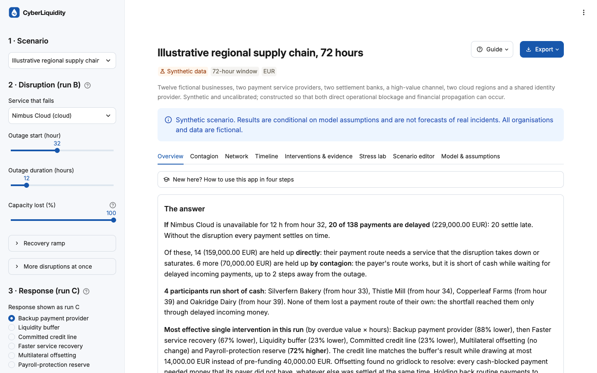
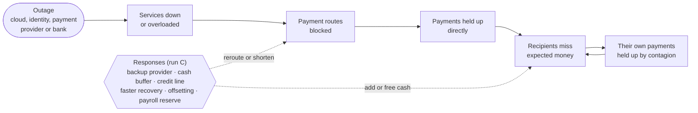
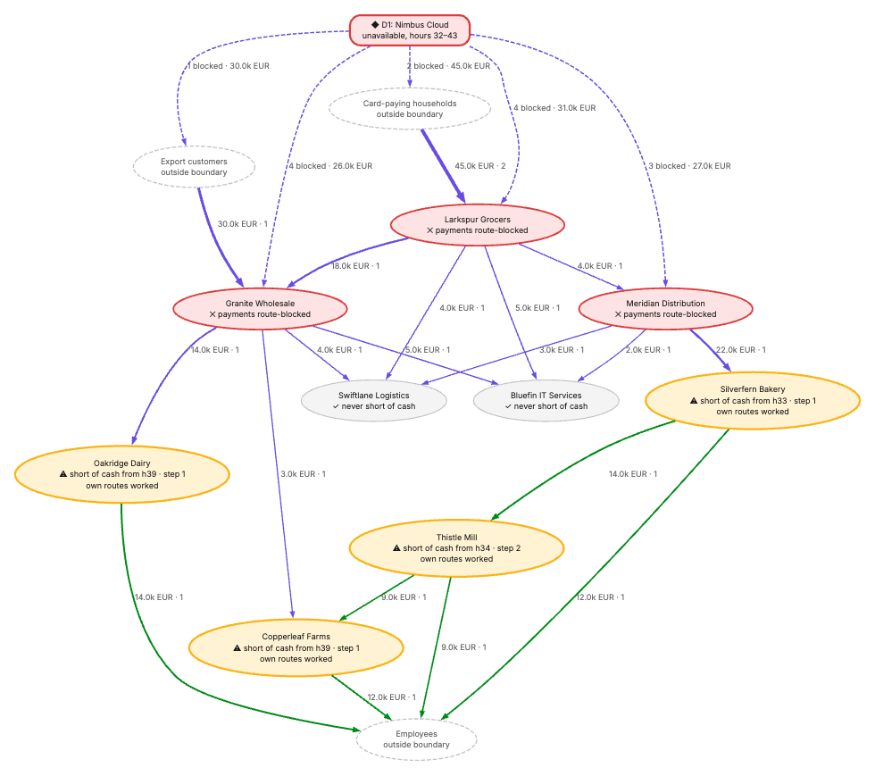
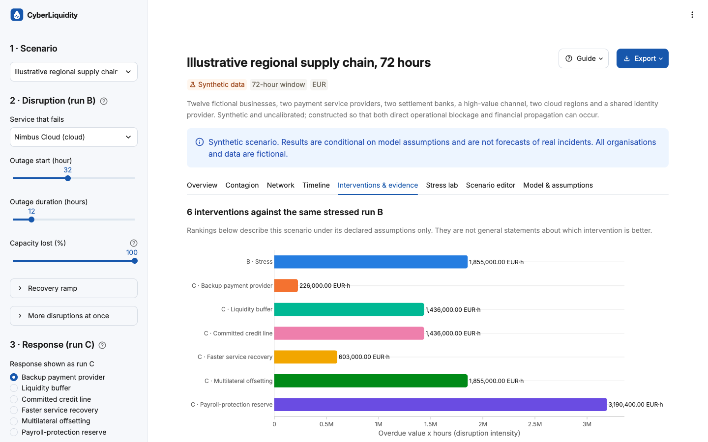
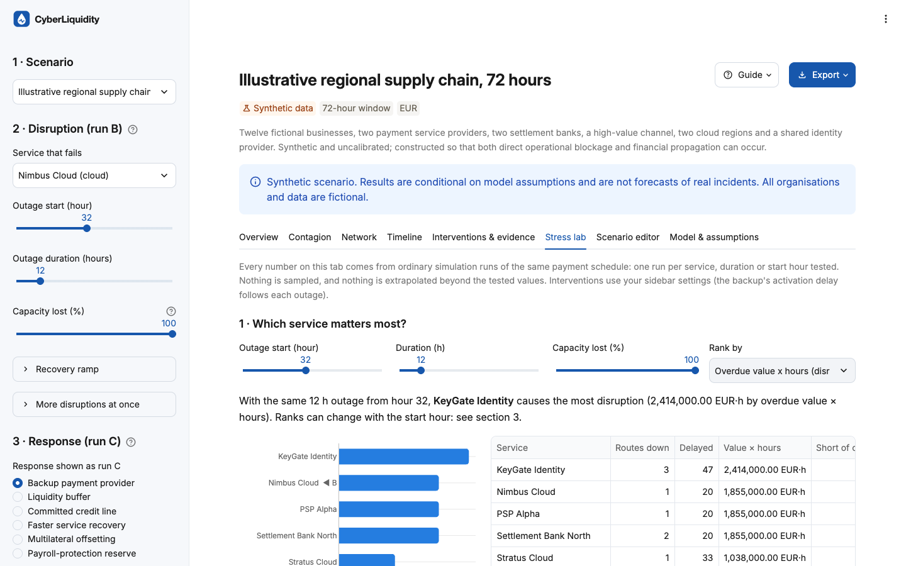

<div align="center">

<picture>
  <source media="(prefers-color-scheme: dark)" srcset="docs/img/logo-dark.svg">
  
</picture>

**Follow a cyber outage through delayed payments to cash shortfalls, and see which response helps most.**

[](https://github.com/EivinDDu/CyberLiquidity/actions/workflows/tests.yml)


[Quick start](#quick-start) ·
[How it works](#how-it-works) ·
[What you can do](#what-you-can-do) ·
[FAQ](#faq) ·
[Model note](docs/MODEL.md) ·
[Changelog](CHANGELOG.md) ·
[Security](SECURITY.md)

</div>

<picture>
  <source media="(prefers-color-scheme: dark)" srcset="docs/img/app-overview-dark.png">
  
</picture>

CyberLiquidity is a deterministic research simulator for one question:

> *If this service becomes unavailable for twelve hours, which payments are delayed, who subsequently runs short of cash, and which intervention reduces the disruption most?*

> [!IMPORTANT]
> **Synthetic scenario. Results are conditional on model assumptions and are not forecasts of real incidents.**
> All organisations and data are fictional and labelled synthetic. The model is not calibrated to any real market and makes no claim of novelty, regulatory compliance, production security or predictive validity.

Intended first users: treasury teams, operational-resilience teams and researchers.

## Quick start

> [!TIP]
> Everything runs on your own computer. The app listens only on `localhost`; nothing is sent anywhere, and no account, API key or internet connection is needed after installation.

**Easiest (macOS):** open the `CyberLiquidity` folder in Finder and double-click **`start.command`**. A Terminal window opens and your browser shows the app at **http://localhost:8501**. Keep the Terminal window open while you use the app; close it, or press Ctrl+C in it, to stop.

- The first start creates `.venv` and installs the pinned dependencies. This needs internet once and takes a minute or two; later starts are immediate.
- If macOS says it cannot verify the file, right-click `start.command`, choose **Open**, and then **Open** again.

**From Terminal:**

```bash
git clone https://github.com/EivinDDu/CyberLiquidity.git
cd CyberLiquidity
./start.command            # or: make app
```

**Then, in the app:**

| Step | Where | What to do |
|:---:|---|---|
| 1 | Sidebar · **Scenario** | Keep *Illustrative regional supply chain* (twelve fictional firms), or upload your own file. |
| 2 | Sidebar · **Disruption (run B)** | Choose the service that fails, when the outage starts and how long it lasts. |
| 3 | Sidebar · **Response (run C)** | Choose one of six responses, such as a backup payment provider or a cash buffer. |
| 4 | **Overview** tab | Read *The answer*: how many payments are late, who runs short of cash, and which response helps most. |

The **Guide** button at the top of the app repeats these steps and explains every term in plain language.

<details>
<summary><b>Manual setup</b> (any platform with Python 3.11 or newer)</summary>

Tested with Python 3.13.7 and 3.11.13 on macOS. The continuous-integration workflow (`.github/workflows/tests.yml`) also runs the full test suite on Linux with Python 3.11 and 3.13 on every push.

```bash
cd CyberLiquidity
python3.13 -m venv .venv
source .venv/bin/activate
python -m pip install --upgrade pip
python -m pip install -r requirements.txt     # pinned direct dependencies
python -m pip install -e .                    # the cyberliquidity package (src/)
python -m pytest                              # run the test suite
streamlit run app/streamlit_app.py            # opens http://localhost:8501
```

- `requirements-lock.txt` pins the complete tested environment (`pip install -r requirements-lock.txt`), and `requirements-dev.txt` the development tools (`make dev`).
- **Dependencies:** the engine itself depends only on Pydantic. Streamlit, Plotly and pandas serve the interface, Matplotlib draws the experiment figure, and pytest runs the tests.
- **Nothing external is needed:** no cloud services, paid APIs, authentication, language model or private data. The typeface is bundled, so the app also works offline.
- `make help` lists shortcuts: `make app`, `make test`, `make lint`, `make audit`, `make bench`, `make experiment`, `make brief`, `make robustness`.

</details>

## How it works

CyberLiquidity keeps two networks apart and couples them explicitly:
- an **operational** network of cloud, identity, payment-provider and settlement services with typed dependencies and shared capacity;
- a **financial** network of funded participants and their payment obligations.

Each payment depends on an operational route. A delay can therefore come from an **operational disruption** (the route is down or saturated) or from **financial propagation** (the payer did not receive money it was expecting):



The tool records both kinds of delay separately and explains every delay from recorded events. It traces how far the delays travel and compares resilience interventions on the same stressed run, alone and in combination. It also tests whether the recommended intervention stays best when the assumptions change.

Every configuration is simulated as a set of runs on the **same payment schedule**:

| Run | What it is |
|:---:|---|
| **A** | Baseline: nothing goes wrong |
| **B** | Stress: the same scenario with the disruption |
| **C** | B plus one response (all six are always run, and optionally every pair) |

## What you can do

### The app

| Tab | Shows |
|---|---|
| **Overview** | **The answer** (plain-language briefing), scenario facts, headline comparisons of A, B and C, overdue value over time, delay distribution, blocking-reason split, full metrics table, key assumptions |
| **Contagion** | How far the disruption travels: payments held up directly vs by contagion, contagion depth, a top-to-bottom contagion map, delayed value by step, per-participant exposure (who ran short of cash, from when, reached at which step, and whether only through delayed incoming money) |
| **Network** | Operational dependencies, financial obligations and the payment-routing coupling as separate layers at any hour; service and participant tables; single-point-of-failure analysis |
| **Timeline** | Backlog (value and count), credit outstanding, overdue obligations by blocking reason, service-capacity heatmap, throughput against capacity, cash balances by participant (small multiples), hourly table |
| **Interventions & evidence** | <ul><li>The six interventions against the same B, with mechanism statements built from the records</li><li>**How robust is the ranking?** Every intervention under ten assumption variants, with the minimax-regret choice</li><li>Combinations against an independence benchmark</li><li>The **exact liquidity backstop**</li><li>The liquidity-buffer sweep (smallest *tested* buffer)</li><li>A per-payment trace with cited event IDs ("why was this payment delayed?")</li><li>Obligations unsettled at the horizon</li></ul> |
| **Stress lab** | <ol><li>Which service matters most (the same outage applied to every service, with the best intervention for each)</li><li>How long the outage can last before an outcome breaks (longest tolerated outage per intervention)</li><li>The worst start hour, plus an optional start × duration grid</li></ol>Runs only when you open the tab. |
| **Scenario editor** | Edit opening balances, service capacities and the payment schedule (add or delete payments), or scale and shift them globally. Edits are validated before use, live only in your session, and can be downloaded as JSON. |
| **Model & assumptions** | A glossary, `docs/MODEL.md` and the exact scenario JSON simulated |

<table>
<tr>
<td width="50%"><br><sub><b>Contagion map.</b> Red: payments blocked by the outage itself. Amber: firms short of cash only because money they expected was late.</sub></td>
<td width="50%"><br><sub><b>Interventions & evidence.</b> All six responses against the same stressed run, then robustness, combinations and the exact liquidity backstop.</sub></td>
</tr>
<tr>
<td colspan="2"><br><sub><b>Stress lab.</b> Which service matters most, how long an outage can last before payroll and tax payments are late, and the worst time for it to start.</sub></td>
</tr>
</table>

**Sidebar controls:**
- the scenario (bundled, uploaded, or your edited version);
- the disruption: service, start hour, duration, capacity lost in %, an optional recovery ramp, and up to two more disruptions at the same time;
- the response shown as run C, with the parameters of all six interventions;
- the ranking metric, and whether to run every pair of interventions.

**Export menu** (top right):
- **Briefing report (.html)**: one self-contained file with the answer, charts, tables, assumptions and reproduction digests. Share it with someone who does not run the app; it opens offline in any browser.
- **All runs (.zip)**: every run's exact `scenario.json`, the full event ledger (`events.csv`), cash ledger, outcomes, blocking records, time series and a `manifest.json` with SHA-256 digests.
- **Stressed scenario (B) JSON**: exactly what was simulated as run B.

**Accessibility:** light and dark themes (the ⋮ menu at the top right: *System*, *Light* or *Dark*), with text contrast checked against WCAG AA. Every bar and line chart has a *Show the numbers as a table* view. Charts never rely on colour alone: they have legends and labels, and status is also marked with ✓, ⚠ and ✕. A deep link opens any tab directly, for example `http://localhost:8501/?tab=Stress+lab`.

### The command line

<details>
<summary><b>All commands</b></summary>

```bash
cyberliquidity brief scenarios/default_72h.json          # the plain-language answer
cyberliquidity robustness scenarios/cluster_gridlock_48h.json   # does the best intervention stay best?
cyberliquidity run scenarios/default_72h.json --out runs/default        # prints the results digest
cyberliquidity compare scenarios/default_72h.json --out runs/compare    # A, B and B + each candidate intervention
cyberliquidity backstop scenarios/default_72h.json       # exact liquidity backstop per participant
cyberliquidity criticality scenarios/default_72h.json --start 32 --duration 12
cyberliquidity profile scenarios/default_72h.json --service cloud_nimbus --start 32 --outcome priority_on_time
cyberliquidity sweep scenarios/default_72h.json --participants oakridge,silverfern,thistle,copperleaf --grid 0,5000,10000,20000,30000
cyberliquidity validate scenarios/default_72h.json
cyberliquidity generate --seed 7 --participants 40 --obligations 800 --out runs/random_7.json   # random structural scenario
cyberliquidity generate-default --out scenarios/default_72h.json        # regenerate the synthetic fixture
cyberliquidity generate-default --which cluster                         # regenerate the circular-trade fixture
cyberliquidity schema --out docs/scenario.schema.json
cyberliquidity --allow-large run big_scenario.json       # lift the size and complexity limits
```

A file that cannot be used is explained in plain language, and the command exits with status 2.

</details>

**Reproducing an exported run:** `cyberliquidity run <run folder>/scenario.json` must print the `results_digest` recorded in the bundle's `manifest.json`.

### The research experiments

```bash
python experiments/redundancy_vs_liquidity.py     # experiment 1, about 8 s
python experiments/gridlock_and_hoarding.py       # experiment 2, about 3 s
```

**Experiment 1** compares three cases:
- direct operational blockage;
- delayed incoming cash;
- a common-mode identity-provider outage.

Each case is run at eight outage durations with seven intervention settings, with the payment schedule held constant. The experiment then checks robustness under alternative ordering and recycling rules and under shifted outage start times, and computes the exact liquidity backstop of every stressed run. It runs 1,837 deterministic simulations.

**Experiment 2** asks two questions: when does multilateral offsetting resolve gridlock after an outage, and do firms that hold cash back for payroll protect it, and at what cost to everyone else? It uses both built-in scenarios and 300 random test structures, and runs 1,257 deterministic simulations.

Outputs go to `experiments/output/`; the write-up of both is in [docs/EXPERIMENT.md](docs/EXPERIMENT.md).

## What is new in v0.4

See [CHANGELOG.md](CHANGELOG.md) for details.

- **Faster, with the same results.** The seven benchmark workloads take 40% less time in total (1,673 ms → 1,003 ms), and the exact liquidity backstop 64% less. Every simulated number is unchanged: 114 recorded 0.3 result digests are reproduced byte for byte. Measured with `make bench`; timings depend on the machine.
- **Protective layers.**
  - Scenario files are checked before anything runs: size, encoding, structure, plain-text names and complexity.
  - Exported spreadsheets cannot run formulas.
  - An independent integrity audit re-checks every run shown, and the result is at the bottom of the page.
  - The app renders no raw HTML, and each tab contains its own errors.
  - CI adds lint and security scans, pinned actions and fuzz tests. See [SECURITY.md](SECURITY.md).
- **A cleaner, easier app.**
  - A new light and dark design with the bundled Inter typeface.
  - Four numbered steps in the sidebar, *Guide* and *Export* menus, a quick start and a plain-language glossary.
  - Table views for every bar and line chart.

<details>
<summary><b>Earlier versions</b></summary>

**v0.3**
- **How robust is the answer?** The comparison is re-run under ten one-at-a-time changes to the assumptions: settlement rules, outage timing and length, balances, throughput.
  - The app shows a grid of every intervention's effect in every variant and names the minimax-regret choice.
  - "The answer" says in one paragraph whether the recommendation survives.
  - No variant is weighted, and nothing is a probability.
- **Multilateral offsetting (gridlock resolution)**: a liquidity-saving mechanism that settles queued payments together when every participant's net position is covered, with net cash movements through a clearing account.
- **Payroll-protection reserve**: a treasury rule in which firms hold back routine payments to keep cash for their own urgent ones. It is a behavioural rule, not added money, and in these scenarios it usually makes the network's disruption worse.
- **A second built-in scenario**, a circular-trade cluster in which an outage causes real gridlock.
- **Experiment 2: gridlock and hoarding.**
  - Offsetting helps only in a middle band of cash, and never in the one-directional supply chain.
  - Hoarding that helps one firm alone stops helping once every firm does it, and it can cancel a liquidity buffer entirely.
- **Verification**: the reference model covers both new rules (300 random scenarios, mutation-checked), and v0.2 results are reproduced byte for byte.

**v0.2** added the plain-language answer, contagion analysis, committed credit lines, the exact liquidity backstop, intervention pairs, the stress lab, the scenario editor, the HTML report and differential testing:

- **The answer, in plain words**: a briefing at the top of the app, and `cyberliquidity brief`, answers the central question from recorded results.
- **Contagion analysis**: how many steps each delay is from the outage, a contagion map, and who ran short of cash without ever losing a payment route.
- **Committed credit lines**: a fourth intervention, drawn on demand with every draw and repayment in the ledger. In this model it settles exactly like an equal-sized pre-funded buffer, but uses only the liquidity actually needed.
- **Exact liquidity backstop**: the smallest pre-funding per participant that reproduces the unlimited-liquidity outcome. It is found by search and re-checked by simulation, instead of guessed on a grid.
- **Combinations**: every pair of interventions is run together and compared with an independence benchmark (complementary, overlapping or roughly independent).
- **Stress lab**:
  - which service matters most;
  - the longest outage that keeps payroll and tax payments on time;
  - the worst start hour;
  - a start × duration grid.
- **App additions**: concurrent disruptions, a validated **scenario editor**, and a one-file **HTML briefing report** that works offline.
- **Verification**: the engine is checked against an independent reference implementation on 300 random scenarios, and reproduces version 0.1's results byte for byte. It is also 2× faster on large networks.
- **Experiment v2**: a third (common-mode) case, the credit line and a combination, start-time robustness and the exact backstop.

</details>

## The model in brief

Full rules, equations, metric definitions and proofs: [docs/MODEL.md](docs/MODEL.md).

- **Time and money**: one-hour steps; integer minor currency units; one configurable currency, no FX. A payment due in hour *h* is on time if it settles by the end of hour *h*; it cannot settle earlier.
- **Operational network**: an edge `A → B` means A depends on B. `requires_all` means every listed service is needed; a `requires_any` group needs only one of its members (failover). Capacity is the bottleneck of the service's own state and its dependencies, and each service has one capacity pool shared by all users. Dependency cycles are rejected in this version.
- **Each hour**:
  1. update service states;
  2. apply scheduled intervention funding;
  3. queue newly due obligations;
  4. settle in order of `(priority, due hour, id)`, as if rescanning from the top after every settlement, so that cash received can fund further payments in the same hour (within-step recycling). A payer with a credit line draws exactly any shortfall; a payer under a reserve rule releases routine payments only from cash it does not need to keep;
  5. with offsetting switched on, settle covered sets of queued payments together, then repeat step 4;
  6. record every reason each remaining obligation is blocked;
  7. repay credit from end-of-hour cash.
- **Settlement** is atomic and in full: no partial payments or overdrafts. Intraday credit exists only as the explicit credit-line intervention, and netting only as the explicit offsetting intervention.
- **Invariants**, checked by the engine and re-checked by the tests and the integrity audit:
  - a payment settles at most once;
  - no negative balances;
  - equal debit and credit;
  - cash conserved within the boundary, with external flows, funding and credit recorded;
  - credit within its limits;
  - every offsetting batch nets to zero;
  - shared capacity respected;
  - no bypassing an unavailable route;
  - unsettled obligations stay visible.
- **Not computed**: economic loss, insolvency, "liquidity required" read from overdue amounts, probabilities, expected losses, confidence intervals or ROI.

## Scenario files

A scenario is a single JSON document (schema: [`docs/scenario.schema.json`](docs/scenario.schema.json)) containing:
- `currency` and `horizon_hours`;
- `services` (with `capacity_per_hour`, `requires_all` and `requires_any`), `routes` (`path`), `participants` (`initial_balance`), `external_parties` and `obligations` (`payer`, `recipient`, `amount`, `due_hour`, `priority`, `routes`);
- `disruptions`, plus `interventions` applied in the run: `backup_route`, `liquidity_buffer`, `faster_recovery`, `credit_line`, `offsetting` or `priority_reserve`;
- `candidate_interventions` used as comparison presets;
- `settings` (ordering and recycling).

Validation rejects, with clear messages:
- unknown references and duplicate IDs;
- amounts that are not positive;
- times outside the horizon;
- payments from a party to itself, or between two external parties;
- dependency cycles;
- buffers, credit lines or reserve rules for parties outside the boundary, overlapping credit lines or reserve rules, and more than one offsetting intervention;
- unknown fields;
- names and labels that are not plain text (markup, web addresses, invisible or control characters), and over-long texts;
- files that are too large, not UTF-8, or too complex to simulate interactively (the command line accepts larger files than the app).

## Trust and verification

| Check | What it guarantees |
|---|---|
| **Integrity audit** (every run in the app) | The cash ledger replays exactly to every recorded balance; ids, settlement events and totals are consistent. Shown at the bottom of every page. |
| **Engine invariants** | The engine stops with an error rather than produce a result that breaks conservation, limits or capacity. |
| **Differential tests** | An independent reference model agrees with the engine on 300 random scenarios; deliberately injected bugs are caught. |
| **Golden digests** | Results of versions 0.1, 0.2 and 0.3 are reproduced byte for byte where the rules did not change. |
| **Fuzzing** | Random bytes, random text and randomly corrupted scenarios are always loaded or refused cleanly, never crash. |
| **CI on every push** | Tests on Python 3.11 and 3.13 (any warning fails), ruff lint, bandit, pip-audit. |

<details>
<summary><b>The test suite</b> (486 tests)</summary>

`python -m pytest` runs 486 tests, among them:
- the three-participant hand example and hand examples for credit lines, offsetting (cycles, net settlement through the clearing account, the removal rule and its tie-break, capacity, next-step recycling, credit draws) and the reserve rule (holding back, look-ahead window, undrawn credit);
- invariant tests over 31 scenario variants, six of them random, including offsetting batches that must net to zero;
- **differential tests**: the engine against an independent reference model on 300 random scenarios, offsetting batches included (mutation-checked: deliberately injected bugs are caught);
- checks that the recorded results digests of versions 0.1, 0.2 and 0.3 are reproduced byte for byte;
- tests that each 0.4 speed-up gives exactly the answer of the slower path it replaces;
- the input checks, plain-text fields, CSV formula guard and integrity audit, including tampered results that the audit must reject;
- property-based fuzzing (Hypothesis) of the loader, the audit and the CSV guard;
- the robustness check (variants, regret, minimax), and both experiments: a fresh run must reproduce the committed outputs byte for byte;
- the backstop theorems (sufficiency always; tightness under next-step recycling) on random scenarios;
- credit line ≡ buffer equivalence;
- contagion generations, including gridlock;
- the stress lab, combinations and the briefing text;
- operational rules, interventions and validation errors;
- determinism, explanations and exports, the CLI, and experiment reproducibility from `config.json`;
- the HTML report;
- headless tests of every app tab, the Guide and Export menus, the integrity footer, refused scenarios, the error boundary, the scenario editor and concurrent disruptions via `streamlit.testing`.

</details>

## FAQ

<details>
<summary><b>Is any of the data real?</b></summary>

No. Every organisation, balance and payment in the built-in scenarios is fictional and generated for this tool (`src/cyberliquidity/synthetic*.py`). Please use fictional data in your own scenarios too.
</details>

<details>
<summary><b>Is this a forecast of what would happen in a real outage?</b></summary>

No. Results are conditional on the model's assumptions and are not forecasts of real incidents. The tool shows how a disruption *could* travel through a stated network under stated rules, and compares responses under those rules. It computes no probabilities, expected losses or returns on investment.
</details>

<details>
<summary><b>Does it need the internet or an account?</b></summary>

Only once, to install the pinned packages. After that it runs entirely on your computer: the typeface is bundled, the app listens only on `localhost`, and usage statistics are switched off.
</details>

<details>
<summary><b>Can I use my own scenario?</b></summary>

Yes. Choose *Upload your own scenario…* in the sidebar, or edit a built-in one on the **Scenario editor** tab. The format is described in [`docs/scenario.schema.json`](docs/scenario.schema.json), and the built-in files in `scenarios/` are working examples.
</details>

<details>
<summary><b>My file was refused. Why?</b></summary>

Every file is checked before anything is simulated, and the app lists each problem in plain language. Common causes:
- a reference to an id that does not exist;
- a time outside the horizon;
- a name containing markup or a web address;
- a file saved in an encoding other than UTF-8.

The app also limits the size of a scenario, because it runs over a hundred simulations for every setting. For larger files, use the command line, which accepts larger scenarios, or add `--allow-large`.
</details>

<details>
<summary><b>How can someone else check my result?</b></summary>

Download *All runs (.zip)* from the **Export** menu. Running `cyberliquidity run <folder>/scenario.json` must print the same `results_digest` as the bundle's `manifest.json`. The same input always gives the same digest.
</details>

<details>
<summary><b>How do I stop the app?</b></summary>

Close the Terminal window that opened with it, or press Ctrl+C in it.
</details>

## Project layout

<details>
<summary><b>Folders and modules</b></summary>

```
src/cyberliquidity/     engine package (UI-independent)
  models.py             validated scenario model (Pydantic): services, routes, participants, obligations, disruptions, interventions
  operational.py        service state, capacity, dependency propagation, single points of failure
  engine.py             hourly settlement engine, credit lines, offsetting, reserve rules, ledgers, blocking reasons, invariant checks
  metrics.py            metric definitions and export tables
  compare.py            A/B/C comparisons, combinations, independence benchmark, mechanism statements
  cascade.py            contagion generations and participant exposure
  analysis.py           stress lab (criticality scan, duration/start profiles, impact surface) and ranking robustness
  briefing.py           plain-language answer generated from recorded results
  explain.py            deterministic explanation traces from events
  sweep.py              buffer grid search, cash-unconstrained reference, exact liquidity backstop
  variants.py           scenario variants and intervention builders
  generator.py          seeded random scenarios (testing and scale)
  export.py             JSON/CSV exports, reproducible zip bundles, digests
  safety.py             input checks and limits, CSV formula guard
  audit.py              independent integrity audit of finished runs
  synthetic.py          generator of the default synthetic scenario
  synthetic_cluster.py  generator of the circular-trade (gridlock) scenario
  cli.py                command-line interface
app/                    Streamlit interface (streamlit_app.py); charts, graphs, theme, layout helpers, logo and HTML report in ui/
app/static/fonts/       the Inter typeface (SIL Open Font License 1.1, licence file included)
scenarios/              default_72h.json (12 firms, 72 h), cluster_gridlock_48h.json (8 firms, 48 h), three_participant.json (hand example)
experiments/            redundancy_vs_liquidity.py, gridlock_and_hoarding.py and their committed outputs
benchmarks/             bench_engine.py: timings of seven engine workloads (make bench)
docs/                   MODEL.md, EXPERIMENT.md, NEXT_STEPS.md, scenario.schema.json, README images
tests/                  unit, invariant, differential (reference model), golden-digest, fuzz, safety, integration, experiment, report and app tests
start.command           double-click launcher (macOS); the Makefile has the same shortcuts
```

</details>

## Not implemented yet (deliberately out of scope)

- Operational dependency cycles (rejected), partial payments, liquidity-saving mechanisms other than the greedy offsetting rule, credit-line fees, collateral and expiry, cut-off times and settlement cycles.
- Behavioural responses other than the stylised reserve rule (cancellations, penalties, learning), and multiple currencies.
- Optional cost assumptions for interventions. No costs are modelled; if added, they must be labelled as user-provided or illustrative.
- An HTTP API (the engine is UI-independent, so an API is a thin layer) and importers from treasury or ERP systems.
- Uncertainty or Monte Carlo modelling. It is intentionally absent until defensible distributions exist.
- Real data, and the security controls real data would need. See [docs/NEXT_STEPS.md](docs/NEXT_STEPS.md) for the data, domain review and partner validation required before institutional use.

---

<sub>Third-party asset: the Inter typeface by The Inter Project Authors, used under the SIL Open Font License 1.1 (`app/static/fonts/Inter-LICENSE.txt`).</sub>
