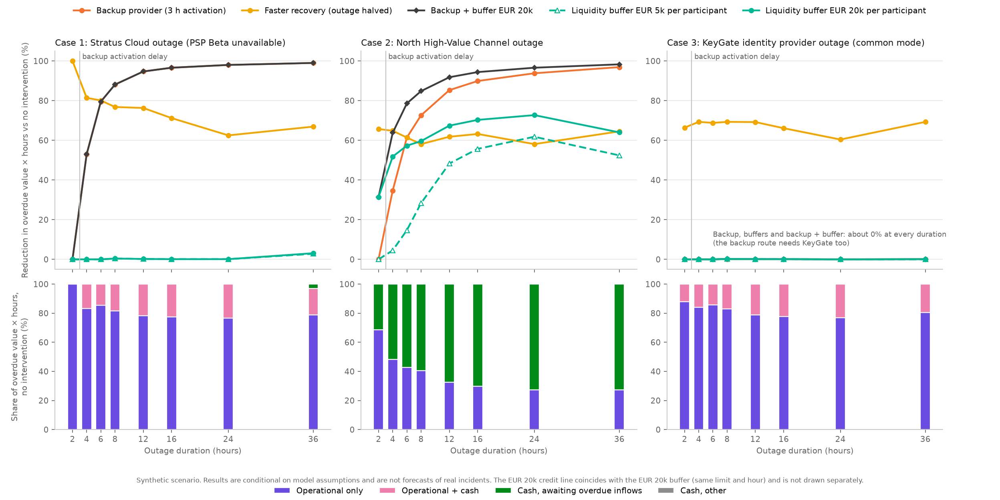
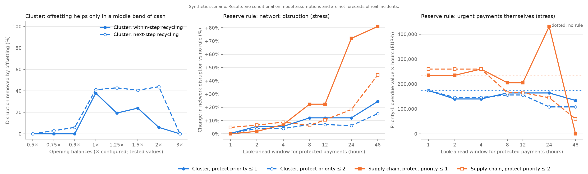

# Experiments

> **Synthetic scenario. Results are conditional on model assumptions and are not forecasts of real incidents.** The findings below describe this model on its illustrative networks under the stated assumptions. They are not general truths about banking or payment systems.

Two deterministic experiments ship with the simulator:

1. [Operational redundancy vs additional liquidity](#experiment-1-operational-redundancy-vs-additional-liquidity): version 2, since 0.2.
2. [Payment gridlock and liquidity hoarding](#experiment-2-payment-gridlock-and-liquidity-hoarding): new in 0.3.

## Experiment 1: operational redundancy vs additional liquidity

**Question.** When does operational redundancy reduce payment disruption more than additional liquidity does, and when does the ranking reverse?

**Reproduce:** `python experiments/redundancy_vs_liquidity.py`. It takes about 11 s and runs 1,837 deterministic simulations:

- 504 comparison runs;
- 360 runs moving the start hour;
- 973 runs inside the 24 exact-backstop computations.

It writes to `experiments/output/redundancy_vs_liquidity/`:

| File | Content |
|---|---|
| `config.json` | Every parameter and every comparison run's disruption, intervention(s), settings and scenario digest |
| `results.csv` | One row per comparison run: metrics, mechanism shares, liquidity used, scenario and results digests |
| `rankings.csv` | Intervention order (ties marked `=`) and % reduction for each case, duration and setting |
| `mechanism_split.csv` | Blocking-category shares and mechanism counts of the stressed runs |
| `complementarity.csv` | Backup + buffer together versus the independence benchmark |
| `start_offsets.csv` | Backup vs buffer with the outage moved by −6 to +6 h |
| `backstop.csv` | Exact liquidity backstop of every stressed run |
| `findings.md` | Generated tables (the source for the numbers below) |
| `comparison.png` | The figure below |

Version 1 of this experiment had two cases and three interventions. Version 2 adds the following. All numbers that v1 also reported are unchanged, because the rules they rely on did not change. Rerunning version 2 with engine 0.3 changes no number either; only the results digests differ, because they include the engine version.

- a common-mode case;
- an on-demand credit line;
- the backup + buffer combination;
- a start-time robustness check;
- the exact liquidity backstop;
- a materiality threshold for verdicts.

### Design

- **Held constant**: the payment schedule, opening balances and network of `scenarios/default_72h.json`, with 138 obligations over 72 hours.
- **Case 1: Stratus Cloud outage from hour 32.** PSP Beta becomes unavailable, so the nine smaller firms cannot send payments. Expected to be dominated by *direct operational blockage*.
- **Case 2: North High-Value Channel outage from hour 31.** It blocks one daily contract payment into Meridian Distribution, which funds an intraday chain: distributor → bakery → mill → farm. Every chain firm's own route works. Expected to be dominated by *delayed incoming cash*.
- **Case 3: KeyGate identity provider outage from hour 32.** Every route in the network needs KeyGate, so no backup is independent of the failure. This is the *common-mode* case.
- **Outage durations:** 2, 4, 6, 8, 12, 16, 24 and 36 h, at 100% severity.
- **Interventions**, each applied to the same stressed run:
  - **Backup provider.** The affected primary route may reroute via the unaffected route with the most capacity, chosen by the dependency analysis. The backup becomes usable **3 h after the outage starts** and shares its capacity with that provider's own clients. In case 3 the suggested backup is flagged as not independent.
  - **Liquidity buffer.** EUR 5,000 or EUR 20,000 is paid to *every* participant (12 firms; EUR 60k or 240k in total) at hour 0. It is untargeted on purpose.
  - **Credit line.** Every participant gets an on-demand facility of EUR 20,000 from hour 0, drawn only when a payment would otherwise fail for lack of cash and repaid from end-of-hour cash.
  - **Faster recovery.** The outage is halved, rounded down to whole hours.
  - **Backup + EUR 20k buffer together**, to test complementarity.
- **Metric:** overdue value × hours, i.e. how much payment value is late and for how long. This is not a loss measure.
- **Robustness, part 1 (engine rules):** the default rules (priority order, within-step recycling); FIFO ordering that ignores priority; and no within-step recycling, where cash received is usable from the next hour.
- **Robustness, part 2 (calendar):** the backup-versus-buffer comparison repeated with every outage moved by −6, −3, +3 and +6 h.
- **Materiality:** backup-versus-buffer verdicts count differences below 1% of the no-intervention disruption as *practically tied*, so that negligible differences are not read as reversals.

### Results (default settings)

**Three cases, three mechanisms.**

- **Case 1:** 77–100% of overdue value × hours is blocked *only* by operational reasons; cash-only blocking is 0% up to 24 h and 3% at 36 h.
- **Case 2:** cash-only blocking while awaiting overdue inflows (financial propagation) makes up 31% at 2 h, then 52–73% from 4 h upward. One directly blocked payment (two at 36 h) leaves 3 to 11 others delayed by cash; at 12 h the chain runs four links deep.
- **Case 3:** 77–88% is blocked by operational reasons only, and the rest by operational reasons *and* cash. Cash alone never blocks anything.

**Case 1: liquidity does nothing; the choice is between redundancy and faster recovery.**

| Outage | Backup | Faster recovery | Buffer 5k | Buffer 20k / credit line |
|---:|---:|---:|---:|---:|
| 2 h | 0% | **100%** | 0% | 0% |
| 4 h | 53% | **81%** | 0% | 0% |
| 6 h | 80% | **80%** | 0% | 0% |
| 8 h | **88%** | 77% | 0% | 0% |
| 12 h | **95%** | 76% | 0% | 0% |
| 24 h | **98%** | 62% | 0% | 0% |
| 36 h | **99%** | 67% | 3% | 3% |

*Reduction in overdue value × hours versus no intervention; bold = best single intervention.*

- **Short outages:** faster recovery ranks first. The backup cannot activate in time; at 2 h the outage is over before the 3 h activation.
- **8 h and longer:** the backup ranks first.
- **Buffers:** no effect up to 24 h at either size, because every blocked hour also has an operational reason, which cash cannot remove.

**Case 2: the ranking between redundancy and liquidity reverses with outage duration.**

| Outage | Backup | Faster recovery | Buffer 5k | Buffer 20k / credit line | Backup + buffer 20k |
|---:|---:|---:|---:|---:|---:|
| 2 h | 0% | **66%** | 0% | 31% | 31% |
| 4 h | 35% | **65%** | 4% | 52% | 64% |
| 6 h | **61%** | **61%** | 15% | 57% | 79% |
| 8 h | **73%** | 58% | 28% | 60% | 85% |
| 12 h | **85%** | 62% | 48% | 67% | 92% |
| 24 h | **94%** | 58% | 62% | 73% | 97% |
| 36 h | **97%** | 64% | 52% | 64% | 98% |

- **Up to 4 h:** the EUR 20k buffer beats the backup. It works from the first hour, while the backup needs 3 h to activate.
- **From 6 h:** the backup is better. Restoring the one blocked contract payment lets the whole chain settle, while the buffer cannot remove the direct blockage.
- **At 36 h:** the buffer's benefit falls, because the outage then also blocks the next day's contract payment, and the fixed buffer has already been spent.
- **EUR 5k buffer:** never beats the backup. At that size it does not cover the distributor's shortfall at the top of the chain.

**Case 3: when redundancy is illusory, only recovery helps.**

| Outage | Backup | Faster recovery | Buffer 5k | Buffer 20k / credit line |
|---:|---:|---:|---:|---:|
| 2 h | 0% | **66%** | 0% | 0% |
| 6 h | 0% | **69%** | 0% | 0% |
| 12 h | 0% | **69%** | 0% | 0% |
| 24 h | 0% | **60%** | 0% | 0% |
| 36 h | 0% | **69%** | −0% | 0% |

- **The backup removes nothing at any duration.** It needs the same identity provider as the route it replaces. The dependency analysis flags this in advance, and the criticality scan ranks KeyGate as the most critical service in the network.
- **Liquidity removes well under 1%.** Every payment that is short of cash is also route-blocked in the same hours.
- **Buffers can make things worse.** At 36 h the EUR 5k buffer is marginally *worse* than no intervention, by 200 EUR·h. Extra cash changes which payments use the scarce post-outage capacity first. Outcomes in this model are not guaranteed to improve monotonically with liquidity.

**The credit line settles exactly like the buffer of the same size, with a fraction of the liquidity.** This holds in every case, duration and setting, as section 7.4 of the model note shows it must. A test checks it on random scenarios as well. Two examples of the liquidity actually drawn:

- **Case 2, 12 h:** the EUR 20k-per-firm credit line drew EUR 12,000 at peak; the equal-outcome buffer pre-positioned EUR 240,000.
- **Case 1, 12 h:** it drew EUR 4,300 at peak.

**Targeting matters more than size.** The exact backstop finds the smallest hour-0 pre-funding that reproduces the unlimited-liquidity outcome. Each one was found by search and re-checked by simulation (`backstop.csv`).

- **Case 2, outages up to 24 h:** EUR 12,000 to one firm (Meridian, the top of the chain) achieves exactly what unlimited liquidity for everyone achieves: 52% at 4 h, 67% at 12 h and 73% at 24 h. That is also what the untargeted EUR 240,000 buffer achieves, so twenty times less liquidity, placed at the right firm, does the same.
- **Cases 1 and 3, up to 24 h:** at most EUR 1,300 to one firm is ever useful. Everything else is route-limited: 33 and 48 obligations respectively stay delayed whatever the liquidity.

**Combining a backup with a buffer works, but the two partly overlap.** In case 2 the combination is the best option at every duration from 6 h (79–98%); at 4 h it is a close second to faster recovery (64% vs 65%). From 4 h to 24 h it removes 1.7–4.9 percentage points *less* than two independent interventions would. The buffer covers the hours before the backup activates, and the backup then restores the upstream payment that the buffer was covering for. In cases 1 and 3 the buffer adds nothing, so the pair is roughly independent by construction.

### Robustness to confounding assumptions

**Engine rules:** 14 of 24 case-duration verdicts (backup vs EUR 20k buffer) are the same under all three settings. FIFO ordering changed no verdict; removing within-step recycling changed ten.

- **Case 2, 6 h and 8 h:** from *backup better* to *buffer better*. Without recycling, restoring the top of the chain unblocks it only one link per hour, and the crossover moves to between 8 h and 12 h. Buffer and backup reductions are 69% vs 51% at 6 h, and 71% vs 66% at 8 h.
- **Case 3, 2–24 h:** from *practically tied* to *buffer better*. Without recycling, the post-outage backlog waits for cash received in the same hour. A buffer then relieves 31% at 2 h, falling to 2.5% at 24 h.
- **Case 1, 2 h:** from *practically tied* to *buffer better* (a small effect of the same kind).

**Calendar:** 22 of 24 verdicts are the same when the outage start moves by up to ±6 h. Starts that miss every affected payment ("no disruption") are ignored. The two exceptions:

- Case 2 at 4 h: the backup wins when the outage starts three hours earlier.
- Case 3 at 4 h: the buffer wins marginally at +3 h.

Calendar alignment matters more for *whether* the high-value outage causes any disruption than for the ranking. Case 2's outage blocks nothing if it starts after the channel's one daily payment (hour 31) and ends before the next day's payment (hour 55).

**Interpretation.** The within-step recycling assumption favours operational fixes in liquidity-driven cases, and it hides a role for liquidity even in the common-mode case. Where exactly the crossover lies depends on how quickly received cash can be reused within the same hour. That rate must be established with domain data before the result means anything outside the model.

### What these results say, and what they do not

Within this model, the ranking depends on:

1. **Which mechanism dominates.** When every blocked hour has an operational reason (cases 1 and 3), extra liquidity barely reduces disruption at any tested size.
2. **Whether the redundancy is real.** A backup that shares the failed dependency (case 3) is worth nothing during the outage. Only the static dependency analysis reveals this before an incident.
3. **Outage length relative to the backup's activation delay.** Redundancy cannot help outages shorter than its activation time. A pre-positioned buffer helps immediately, but only where the blockage is about cash.
4. **Where the liquidity goes.** A small, targeted amount at the top of a payment chain did what a large untargeted buffer could not.
5. **The recycling assumption** (previous section).

Limitations that matter for interpreting these numbers:

- **Not general results.** The network, calendar and balances were constructed to exhibit the mechanisms, and different networks would give different crossovers.
- **Censoring.** Long outages are right-censored at the 72 h horizon.
- **No costs.** Buffers, credit lines and backups have no cost in the model. The comparison is about disruption removed, not value for money.
- **Fixed backup assumptions.** The backup's activation delay, capacity and independence are fixed by the scenario.
- **Local, not global, minima.** The backstop allocation is locally smallest (no single amount can shrink), not necessarily the smallest total.
- **No probabilities.** No incident likelihoods, expected losses or return on investment were estimated, and none can be read from these results.

## Experiment 2: payment gridlock and liquidity hoarding

**Questions.**

1. **Gridlock.** When does a liquidity-saving mechanism, hourly multilateral offsetting of queued payments (model note, section 7.8), reduce the payment disruption caused by an outage? How does that depend on how much cash the participants hold and on the settlement rules?
2. **Hoarding.** If firms hold back routine payments to keep cash for their own urgent ones such as payroll and tax (section 7.9), are the urgent payments protected, and what does it cost everyone else? Does a rule that helps a firm acting alone still help when every firm uses it?

**Reproduce:** `python experiments/gridlock_and_hoarding.py`. It takes about 5 s and runs 1,257 deterministic simulations:

- 256 runs in the offsetting grid;
- 60 runs in the reserve sweep;
- 24 runs comparing one firm alone with every firm;
- 900 runs on 300 random structures;
- 17 runs in the pair comparisons (baseline, stress, five single interventions, ten pairs).

It writes to `experiments/output/gridlock_and_hoarding/`:

| File | Content |
|---|---|
| `config.json` | Every parameter, the environment, and the digests of both scenarios |
| `offsetting_grid.csv` | Offsetting against no offsetting, by scenario, balance factor, recycling rule and outage duration |
| `reserve_sweep.csv` | The reserve rule by scenario, condition (baseline or stress), protected priority and look-ahead window |
| `reserve_individual.csv` | Each firm applying the rule alone, against every firm applying it |
| `random_structures.csv` | Offsetting and the reserve rule on 300 random test structures |
| `cluster_pairs.csv` | Every pair of the cluster scenario's candidate interventions against the independence benchmark |
| `findings.md` | Generated text and tables (the source for the numbers below) |
| `gridlock_and_hoarding.png` | The figure below |

A test reruns the experiment and checks that every CSV file and `findings.md` match the committed ones byte for byte.

### Design

- **Scenarios.** `scenarios/cluster_gridlock_48h.json` is a circular-trade cluster: eight firms on one industrial estate buy from, rent from and deliver to one another, and the suppliers pay one another round a ring (model note, section 11). `scenarios/default_72h.json` is a one-directional supply chain. Both are stressed by their configured 12-hour cloud outage from hour 32.
- **Offsetting grid.** Every opening balance scaled by 0.5, 0.75, 0.9, 1, 1.25, 1.5, 2 or 3; within-step or next-step recycling; outages of 4, 8, 12 or 24 h. Offsetting is active from hour 0.
- **Reserve sweep.** Every firm applies the rule; it protects priority 1 (payroll, tax, loan repayments) or priorities 1 and 2; look-ahead windows of 1, 2, 4, 8, 12, 24 and 48 h. Run both with the outage (stress) and without it (baseline).
- **One firm alone against every firm.** Under stress, each firm with urgent payments applies the rule on its own (priority 1, 24 h look-ahead). Its own urgent payments are compared with no rule and with every firm applying the same rule.
- **Random structures.** Seeds 0–299 of the test generator, with their random disruptions and settings, without other interventions. They have no economic meaning, and the share of structures in which something happens is not a probability of anything.
- **Metric.** Overdue value × hours. For urgent payments: the overdue value × hours of priority-1 payments.

### Results: gridlock

**In the circular-trade cluster, offsetting removes 38% of the disruption (41% under next-step recycling).** One batch settles the suppliers' ring of seven payments, worth EUR 77,000, in the hour they fall due. Only EUR 5,000 of cash moves, so EUR 72,000 of the gross value needs no cash at all. The rest of the disruption remains: the vehicle maker's payment is route-blocked, and Birch genuinely lacks the cash for its invoices until it arrives.

**It helps only in a middle band of cash.** Reduction by opening-balance factor, 12-hour outage:

| Balance factor | 0.5× | 0.75× | 0.9× | 1× | 1.25× | 1.5× | 2× | 3× |
|---|---|---|---|---|---|---|---|---|
| Within-step recycling | 0% | 0% | 0% | 38% | 19% | 24% | 6% | 0% |
| Next-step recycling | 0% | 3% | 6% | 41% | 43% | 41% | 44% | 0% |

- **Too little cash:** the ring's net payers cannot cover even their net positions. The greedy rule removes their payments, the ring unravels and no batch forms, although the ring stays stuck until the outage ends.
- **Ample cash (3×):** the firms pay one another directly in the hour the ring falls due. There is no gridlock left to resolve.

**In the one-directional supply chain, offsetting never forms a batch**, in all 64 tested combinations of balance factor, recycling rule and outage duration. Its delays come from routes that are down and from cash that is genuinely missing, not from payments waiting for one another.

**Across the 300 random structures**, offsetting formed at least one batch in 78. The disruption was lower in 77, unchanged in 222 and higher in 1. That one case shows that settlement is path-dependent: settling a batch early can move cash away from a participant that needed it for a later payment.

### Results: hoarding

**Under stress, the rule made the network's disruption worse in 27 of 28 tested settings.** Against no rule, the change ranged from +0% to +24% in the cluster and from +0% to +81% in the supply chain. Without any outage it created delays in 14 of 28 settings, by holding back payments that would otherwise have settled on time.

**It often helps the urgent payments themselves, but not reliably.** Under stress their overdue value × hours was:

- in the cluster, lower in 12 settings, unchanged in 2 and higher in none;
- in the supply chain, lower in 7, unchanged in 2 and higher in 5.

**A longer window is not simply more protection.** In the supply chain with priority 1 protected:

- with a 24-hour look-ahead the urgent payments were *worse* off than with no rule, at EUR 431,000·h against EUR 235,000·h;
- with 48 hours they were all paid on time, at the cost of 81% more network disruption.

Whether a firm's own reserve protects its payroll depends on what everyone else holds back.

**What helps one firm alone does not survive everyone doing it.** Under stress, with priority 1 protected and a 24-hour look-ahead:

- **Cluster:** 4 of the 8 firms reduce their own urgent delay by applying the rule alone. Once every firm applies it, 2 of those 4 are no better off than with no rule, and the network's disruption rises from EUR 2,081,500·h to EUR 2,331,900·h.
- **Supply chain:** 2 of 12 firms gain by applying the rule alone, and 1 of them loses that gain once everyone does. The network's disruption rises from EUR 1,855,000·h to EUR 3,190,400·h.

**The rule can cancel other interventions.** In the cluster:

- **With a buffer:** the EUR 20,000 buffer for Birch removes 51% of the disruption alone. Together with the rule the result is 6% *worse* than no intervention, against 45% removed if the two acted independently. Birch keeps the buffer for its own tax and payroll and holds back its supplier invoices.
- **With offsetting:** together with the rule, offsetting forms no batch, because every firm in the ring must keep its payroll cash besides covering its net position.

**Across the 300 random structures** (priority 1, 12-hour look-ahead, every participant):

- total disruption was higher in 267, lower in 29 and unchanged in 4;
- priority-1 overdue value × hours was lower in 265, unchanged in 21 and higher in 14;
- in 237 structures the rule protected urgent payments at the cost of more total disruption.

### What these results say, and what they do not

Within this model:

1. **Gridlock needs a particular structure.** Offsetting matters when payments form cycles in which nobody holds enough cash to start, but every participant's *net* position is affordable. A one-directional supply chain has no such cycles, so its delays need cash or working routes instead.
2. **Liquidity-saving and liquidity are partly substitutes.** With more cash the ring clears on its own; with a targeted buffer at its source (Birch), offsetting adds nothing on top (`cluster_pairs.csv`).
3. **Individually sensible hoarding is collectively costly.** The payments one firm holds back are another firm's incoming money. In these runs the rule usually moved delay from urgent payments to everything else, and sometimes failed even the urgent payments.

Limitations that matter for interpreting these numbers:

- **Not general results.** Two hand-built scenarios and generated test structures; none is calibrated to real firms, payment systems or incidents.
- **One greedy offsetting rule.** It removes the last payment of the participant with the largest uncovered position and does not search for the largest settleable set. An optimising algorithm could settle more. A published simulation study of a gridlock-resolution algorithm on real payment data reports its largest benefit when intraday liquidity is scarce (Bech and Soramäki, Bank of Finland Discussion Paper 9/2001). Here the greedy rule does nothing at the lowest tested balances. Whether the difference comes from the rule, the network or the data has not been investigated.
- **A stylised treasury rule.** Firms know their own calendar perfectly and never learn, negotiate, borrow, cancel or reprioritise.
- **No probabilities.** No incident likelihoods, expected losses or returns were estimated. Counts over random structures describe those structures, not the world.
